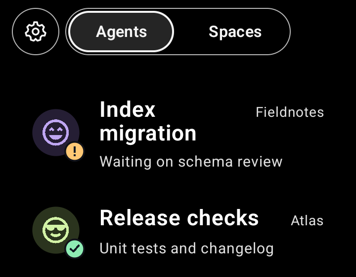
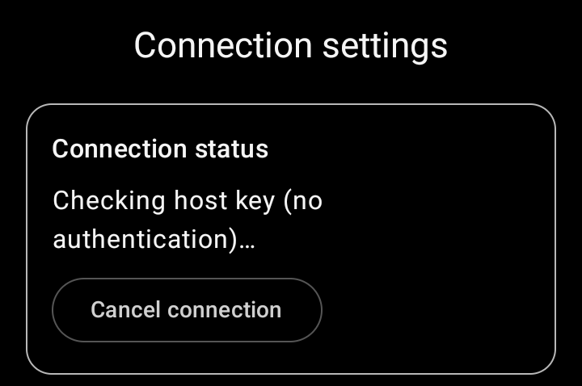

# Herdr Pocket

**Your Herdr workspaces on Android.** Check which agents need you, pick up an existing terminal, or move a file without going back to your desk.

Pocket is an independent client for [Herdr](https://herdr.dev/). Your agents run on your Linux or macOS host; Pocket connects to it over SSH. No Pocket account is required.

[Get started](#connect-to-your-host) · [Build from source](#build-from-source) · [Compatibility](#compatibility)

<p>
  <a href="docs/screenshots/agents.webp"></a>
</p>

*Agents view, captured on Android with demo data.*

## What you can do

- **Find the right session.** See agents in attention order or switch to **Spaces** for agents and shells grouped by workspace. Search, filter by status, and pin the agents you reach for most.
- **Use a real terminal.** Open a running pane, pinch to resize the text, and use the shortcut bar for Tab, Escape, Ctrl, Alt, paste, and a D-pad with Enter and paging keys. Start a terminal in an existing workspace or create a new workspace from **+**.
- **Browse and transfer files.** Open **⋮ → Files** from an agent or shell. Preview images and syntax-highlighted text, toggle wrapping and line numbers, copy paths, upload or download files, and create folders. Deletions ask for confirmation.
- **Dictate or get notified.** Record a prompt using a compatible on-device Android speech service, with optional Enter after transcription. Enable agent alerts for done and blocked events without a push provider or a host-side script.

## Install

Get the signed ARM64 APK from [GitHub Releases](https://github.com/KacperLa/herdr-pocket/releases). If you track Pocket with Obtainium, add this repository and allow pre-releases to follow beta builds.

## Connect to your host

1. On your host, install and run [Herdr TUI](https://herdr.dev/tui/). Leave the Herdr server running with the sessions you want to reach.
2. In Pocket, open **SSH connections** and select **Add connection**. Enter the SSH host and username, choose your private key, and save. The SSH account must be able to reach the Herdr session. For a named session, open the connection’s **Settings** and enter its name under **Advanced options**.
3. Tap **Connect** from the list, or **Connect to Herdr TUI** in settings. On first connection, compare the displayed SHA-256 host fingerprint with one obtained through a trusted route before saving it. Then open an agent or switch to **Spaces** to find a shell.

<a href="docs/screenshots/ssh-verification.webp"></a>

## Compatibility

| Feature | What you need |
| --- | --- |
| Android app | Android 14 or later, on an ARM64 device |
| Herdr TUI | Linux or macOS over SSH. Herdr 0.9.5 is a known target for direct attach; older or newer releases may differ. |
| Files | SFTP on the SSH account. Herdr TUI 0.9.0+ can report the active working directory; otherwise Pocket may show the pane or workspace path instead. |
| Agent alerts | Herdr's event stream, SSH Unix-socket forwarding, and Android notification permission. Reopen Pocket after reboot to reconnect; offline events aren't replayed. |
| Dictation | An Android on-device speech recognizer that accepts recorded audio. |
| Herdr Core | A separate connection mode using [`hc`](https://github.com/herdrdev/herdr-core). It does not share the TUI roster or offer TUI file browsing and alerts. |

Direct TUI attach does not forward Kitty images. If a direct terminal already has an attached client, Pocket does not take it over. For hosts without compatible direct attach, you can run the full TUI with an attach-only custom command under **Advanced options**.

### Saved SSH connections

From a Herdr terminal, go **Back** to that host’s Agents view, then **Back** again to **SSH connections**. Open **Settings** from the host’s row and use **Back** to return to the list. Use **Add connection** to enter another host, username, port, and optional display name, and select its private key. Saving or editing a host does not switch away from your current connection.

Tap the highlighted **Connected** host to reopen its Agents view (or its terminal for a custom attachment). Use **Connect** to switch to another host. Pocket connects to one host at a time and can reconnect to the last selected host at startup once it has been set up and verified. **Remove** asks for confirmation and clears the profile from Pocket without deleting your key file or changing the server. Removing the current host leaves Pocket disconnected until you choose another one.

Open **App settings** on the **SSH connections** screen for app-wide agent alerts, dictation, and Live Voice (including API endpoints and keys). A host’s own **Settings** contains its SSH keys, fingerprint, and connection options.

### SSH trust

Pocket uses SSH public-key authentication and remembers the selected key file through Android's document picker. A changed server key is rejected before authentication. If you deliberately changed the host's key, use **Review changed host key**, verify the new fingerprint independently, and reconnect. Saving a key passphrase is optional and uses Android Keystore-backed encryption.

## Live Voice (beta)

Talk to a running agent through a compatible voice endpoint you configure. Pocket reviews requests and replies by default and uses Herdr to verify the pane and session. [Live Voice setup](docs/live-voice.md) explains which agents can use saved history without a separate text model, how other agents use screen extraction, and what is sent to your provider.

## Build from source

Install JDK 21, Gradle 9.9.1, Android SDK Platform 37.0, and Android Build Tools 36.0.0. Set `JAVA_HOME` for JDK 21. Set `ANDROID_HOME` for the SDK, or point `sdk.dir` in your local `local.properties` at it.

```sh
gradle :app:assembleRelease :app:testDebugUnitTest :termlib:testDebugUnitTest :app:lintRelease
```

The unsigned APK is at `app/build/outputs/apk/release/app-release-unsigned.apk`. For a local-only install, build a debug APK instead with `gradle :app:assembleDebug`. A debug-signed APK cannot update an install signed with a different key.

The [Build unsigned APK workflow](https://github.com/KacperLa/herdr-pocket/actions/workflows/android.yml) also produces an unsigned APK and a checksum. See the [validation notes](VALIDATION.md) and [SSH test fixture](VALIDATION-SSH.md) for test coverage and limitations.

## Credits

Herdr Pocket is not an official Herdr app. It uses [ConnectBot Termlib](https://github.com/connectbot/termlib), libvterm, [mwiede JSch](https://github.com/mwiede/jsch), and Bouncy Castle. See the [Termlib notes and bundled notices](third_party/termlib/README.md).
